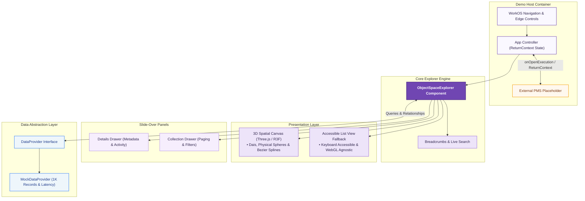
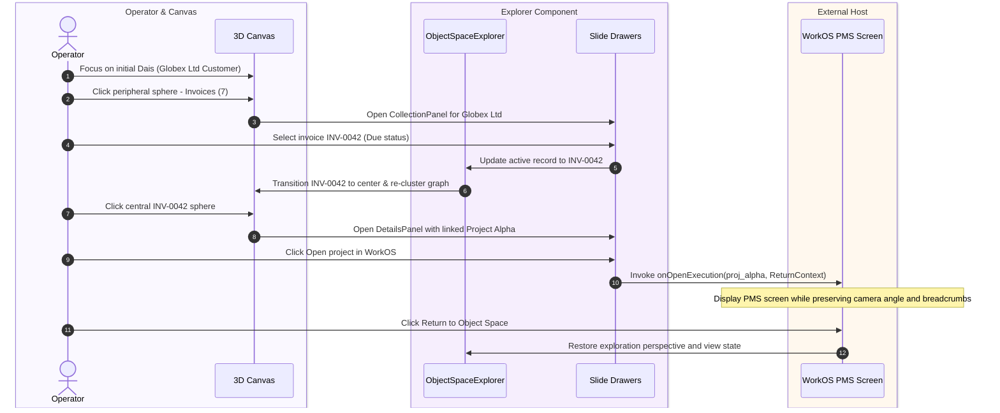

# WorkOS Object Space Explorer

[](https://3-d-work-os-explorer.vercel.app/)
[](https://www.typescriptlang.org/)
[](https://react.dev/)
[](https://threejs.org/)

An interactive 3D business-object graph and navigation experience built for WorkOS. It enables operators to visualize, explore, and traverse business record relationships—such as customers, invoices, projects, tasks, contacts, and contracts—using physical 3D spheres, relationship connections, breadcrumbs, search, and a synchronized List view fallback. Framer Motion provides restrained transitions for the List view and temporary panels, with reduced-motion support.

**Live Deployment:** [https://3-d-work-os-explorer.vercel.app/](https://3-d-work-os-explorer.vercel.app/)

---

## Quick Start

### Installation
```bash
pnpm install --frozen-lockfile
```

### Run Local Development Server
```bash
pnpm dev
```
> Open [http://localhost:3000](http://localhost:3000) in your browser. No API keys or credentials required.

### Clone and run on another device
```bash
git clone https://github.com/Aayushi31032006/3D-WorkOS-Explorer.git
cd 3D-WorkOS-Explorer
pnpm install --frozen-lockfile
pnpm dev --host 0.0.0.0
```
Open `http://localhost:3000` on the same computer, or use the host machine's
local network address (for example `http://192.168.1.20:3000`) from another
device. Node.js 20 or newer is recommended. The app has no credentials or
environment variables.

### Run Automated Tests
```bash
pnpm test
```

### Production Build
```bash
pnpm build
```

---

## Architectural Separation

The codebase follows the strict separation specified in the brief:

```
3D-WorkOS-Explorer/
├── src/
│   ├── types/                  # Shared TypeScript interfaces & models
│   │   └── index.ts            # BusinessObject, DataProvider, ReturnContext, etc.
│   │
│   ├── data/                   # Data-provider abstraction & company-scoped sample records
│   │   ├── sampleData.ts       # Globex Ltd & Initech Corp records, 1,000-record generator
│   │   └── mockDataProvider.ts # DataProvider async implementation with edge states
│   │
│   ├── explorer/               # Reusable ObjectSpaceExplorer component
│   │   ├── ObjectSpaceExplorer.tsx # Top-level explorer controller
│   │   ├── index.ts            # Component public export
│   │   ├── scene/              # Three.js / React Three Fiber 3D scene
│   │   │   ├── Scene.tsx       # Canvas assembly, camera, lighting, drag vs click
│   │   │   ├── Floor.tsx       # Matte floor, circular grooves, soft shadow receiver
│   │   │   ├── Plinth.tsx      # Central stepped circular dais under active sphere
│   │   │   ├── SphereNode.tsx  # Central & peripheral spheres, billboard labels, icons
│   │   │   ├── Connections.tsx # Curved bezier tubes with joint beads
│   │   │   ├── AmbientSpheres.tsx # Soft decorative ambient spheres on floor
│   │   │   └── CameraControls.tsx # OrbitControls, smooth 300-500ms easing, reset
│   │   ├── panels/             # Temporary slide-in drawers (one at a time)
│   │   │   ├── DetailsPanel.tsx    # Single record fields, activity feed, WorkOS handoff
│   │   │   └── CollectionPanel.tsx # Paginated list, search, status filter, close
│   │   ├── views/
│   │   │   └── ListView.tsx    # Accessible table view with keyboard navigation
│   │   ├── components/         # Sub-components
│   │   │   ├── Breadcrumb.tsx  # Clickable breadcrumb path
│   │   │   ├── SearchBar.tsx   # Global record search with live dropdown
│   │   │   ├── ViewSwitch.tsx  # 3D | List switch
│   │   │   └── CameraControlsOverlay.tsx # Zoom +, -, Reset buttons
│   │   └── styles/
│   │       └── explorer.css    # Scoped styles
│   │
│   ├── host/                   # WorkOS demo host application
│   │   ├── App.tsx             # Demo container, return context state manager
│   │   ├── WorkOSHeader.tsx    # Top WorkOS menu (World, Tasks, Object Space, etc.)
│   │   └── PMSPlaceholder.tsx  # Placeholder WorkOS Project screen + Return button
│   │
│   └── test/                   # Acceptance & unit tests
│       ├── setup.ts            # JSDOM WebGL & ResizeObserver mocks
│       └── explorer.test.tsx   # 7 acceptance test suites verifying all brief specs
```

### System Architecture



---

## Verifying Every Requirement

### 1. Canonical Customer Journey



1. Open the app $\rightarrow$ **Globex Ltd** (Customer) is centered on the central plinth.
2. Observe surrounding spheres: **Invoices (7)**, **Projects (2)**, **Contacts (2)**, **Contracts (3)** and the connected task/product groups derived from the sample graph.
3. Click the **Invoices (7)** sphere $\rightarrow$ Opens drawer titled *"Invoices for Globex Ltd"*.
4. Choose **INV-0042** $\rightarrow$ Collection panel closes; `INV-0042` animates to center as the new central record.
5. Surrounding spheres update to show: **Globex Ltd** (Customer), **Project Alpha** (Project), **Payment**, and **Tasks (3)**. Breadcrumb reads `Objects / Globex Ltd / Invoices / INV-0042`.
6. Click the central **INV-0042** sphere $\rightarrow$ Opens **Invoice details** panel:
   - Customer: `Globex Ltd`
   - Amount: `₹42,500`
   - Status: `Due`
   - Due date: `30 October 2026`
   - Linked project: `Project Alpha`
   - Activity: `22 Oct · Invoice created`, `23 Oct · Due date updated`
7. Click **Open project in WorkOS** $\rightarrow$ Triggers `onOpenExecution` callback. The demo host switches to the **WorkOS Project Management System Placeholder** screen with record ID `proj_alpha` and serializable return context.
8. Click **Return to Object Space** $\rightarrow$ Restores previous exploration state, breadcrumb trail, and camera view without jumping to the default customer.

### 2. Visual Direction & Palette Verification
- **Background:** Pale lavender `#F5F3FA`.
- **Central Sphere:** `#B897E3`.
- **Related Spheres:** `#D3BFEF`.
- **Selection / Active:** `#7046B2`.
- **Labels:** `#30264C`.
- **Floor:** Matte floor with subtle concentric circular grooves and soft shadows.
- **Connections:** Smooth curved spline tubes with decorative junction beads.

### 3. Click vs Drag & Empty Space Rule
- **Camera Drag:** Orbiting and dragging does **not** trigger record selection clicks.
- **Empty Space Click:** Clicking empty canvas space does **not** close open panels, deselect records, or navigate backwards.

### 4. Edge States & Demo Controls (in Top Header)
- **Company Switcher:** Switch between `Globex Ltd` and `Initech Corporation`. Old company records and state are cleared cleanly.
- **Test 1K Records:** Toggles 1,000-record invoice collection with 20-records/page pagination.
- **Test Empty:** Simulates an empty relationship group displaying *"No invoices linked yet"*.
- **Test Error:** Simulates API failure displaying *"Could not load this information"* and a working **Retry** button.
- **Restricted Record:** Demonstrates privacy preservation (private fields hidden, access warning shown).

### 5. 3D | List View Switch
- Clicking **List** switches to an accessible tabular view with full keyboard navigation (`Tab`, `Enter`), ARIA landmarks, and visible focus outlines.
- Selection and active object state are preserved across switches.
- Functions as the automatic fallback if WebGL is unavailable.
- The Three.js scene is lazy-loaded so List/fallback users do not pay the 3D bundle cost until a WebGL scene is available.

### Responsive host layout

The WorkOS navigation and demo controls remain available across laptop,
tablet, and phone widths. On narrow screens the navigation and test controls
become horizontally scrollable, while the explorer, collection drawers, and
project handoff screen use the full available viewport. The embedded Electron
preview uses the accessible List fallback when its WebGL implementation
cannot create a stable Three.js renderer; regular Edge, Chrome, and Firefox
use the 3D view when WebGL is available.

---

## Data provider integration

Replace `MockDataProvider` in [src/host/App.tsx](./src/host/App.tsx) with an
implementation of `DataProvider`. The explorer only depends on the public
methods in [src/types/index.ts](./src/types/index.ts). Linked records are
resolved from relationship IDs, so a production provider does not need any
mock-specific helper.

## Demo controls

The header includes company switching, `Test 1K`, `Test Empty`, `Test Error`
and `Test Restricted`. The 1K mode adds stable invoice IDs beginning at
`inv_0048` and the collection loads the resulting 1,000 records 20 at a time.

## Testing & Quality Assurance

The Vitest suite contains 11 acceptance tests covering the initial graph,
List view journey, handoff and return context, dynamic project links, stable
IDs, empty/error/restricted states, company changes, blank-space behavior,
and large-collection paging.
